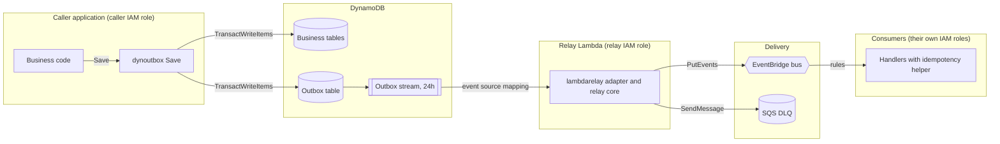

# Threat model

This document lists what can go wrong, security-wise, when dynoutbox is used, what the
library does about it and what is left to the application that uses it. It follows the
[OWASP Top 10:2025](https://owasp.org/Top10/2025/) categories, plus the failure modes of
a distributed system that the Top 10 does not cover.

Nothing is released yet, so most mitigations are planned. Each one names the backlog
story that delivers it, and this document is updated when that story merges.

## 1. Scope and assumptions

dynoutbox is a library, not a service. It runs inside the caller's process and the
caller's AWS account. That splits responsibility three ways:

- **Library**: what the code does or refuses to do (validation, limits, retries, logs).
- **Caller**: what the application or its infrastructure must set up (IAM, encryption
  keys, table and stream settings, alarms, consumer validation). The library cannot
  enforce these, so they are documented in the README (S14).
- **Project**: how the code is built and published (CI, dependencies, repository
  settings).

Assumptions:

- The AWS account, its administrators and the AWS services themselves are trusted.
- Callers pass an AWS SDK client they configured; the library never creates or reads
  credentials and never reads environment variables.
- Event payloads may contain personal data, so they are treated as sensitive everywhere.

Out of scope: the business logic of applications and consumers, vulnerabilities in AWS
services, and the dev-only relay in the planned example service (S13), which is labeled
not for production.

## 2. Assets

| Asset | Why it matters |
| --- | --- |
| Atomicity of business change and event | The whole point of the library: an event exists if and only if the change committed. |
| Event payloads | May hold personal data. Copies live in the outbox table, its stream, the event bus, the DLQ and every consumer. |
| Integrity of events on the bus | Consumers act on events; a forged event is a forged business fact. |
| Relay availability | If the relay stops for longer than the stream keeps records, events are lost. |
| AWS spend | Retry loops and poison events can run up cost (denial of wallet). |
| Published source code | Users build it into their services; a compromised release compromises them. |

## 3. Data flow and trust boundaries

Trust boundaries, where data changes owner or privilege:

1. **Caller code to `Save()`**: event fields come from application code that may carry
   user input. The library validates them before anything reaches AWS.
2. **Outbox table to relay**: the relay trusts only what is in the table, and anyone who
   can write to the table can make the relay publish. Records are decoded defensively.
3. **Relay to EventBridge and SQS**: the relay role is the only principal meant to
   publish these events and to write the DLQ.
4. **Bus to consumers**: consumers receive events from a shared bus and must treat them
   as untrusted input.
5. **Developer to CI to Go module proxy**: the supply chain for the library itself.

## 4. Threat agents

- An attacker holding leaked AWS credentials for one of the roles above.
- Another principal in the same account that can call `PutEvents` on the bus and
  pretends to be the service.
- A compromised or malicious dependency, GitHub Action or contributor.
- An insider or misconfigured role reading the DLQ, the stream or the bus archive.
- A buggy producer that emits malformed or oversized events (no malice needed to cause
  an outage).

## 5. OWASP Top 10:2025

Status values: **in place** (done), **planned (Sx)** (backlog story), **caller**
(documented, the caller must do it), **accepted** (residual risk, see section 7).

### A01 Broken Access Control

Threat: over-broad IAM lets a component read or write more than it needs, for example
the application reading the DLQ or a consumer writing to the outbox table.

| Mitigation | Owner | Status |
| --- | --- | --- |
| Example least-privilege policy per role: the application gets `PutItem` on the outbox table (transactions are authorized per action); the relay gets stream read, `PutEvents` on one bus and `SendMessage` on one queue; consumers get only their idempotency table. | Caller | planned (S14) |
| The application's outbox `PutItem` restricted with the `dynamodb:EnclosingOperation` condition key, so outbox items can only be written inside a transaction, never as a stray single write. | Caller | planned (S14) |
| Relay `PutEvents` permission restricted with the `events:source` condition key to the allowlisted sources. | Caller | planned (S14) |
| DLQ read limited to operators; the queue policy denies everyone else. | Caller | planned (S14) |

### A02 Security Misconfiguration

Threat: the infrastructure is set up in a way that silently breaks the guarantees: a
stream view type without the new image, TTL disabled, no DLQ, no partial batch
failure reporting on the event source mapping.

| Mitigation | Owner | Status |
| --- | --- | --- |
| Config structs validated at construction; invalid settings fail fast with typed errors instead of falling back to defaults. | Library | planned (S6 to S10) |
| A record without a new image is a configuration error, reported loudly, never skipped as if it were an empty event. | Library | planned (S6) |
| Required table, stream and event source mapping settings documented (bisect on error, `ReportBatchItemFailures`, retry and record age limits). | Caller | planned (S10, S14) |
| Repository ruleset on `main`: pull request and CI required, no force push or deletion, linear history. | Project | in place |

### A03 Software Supply Chain Failures

Threat: a dependency, GitHub Action or tool is compromised and ships malicious code to
the library or its users.

| Mitigation | Owner | Status |
| --- | --- | --- |
| `go.sum` lockfile, verified against the Go checksum database. | Project | in place |
| Few dependencies; each new one needs a written reason, license and maintenance check. | Project | in place |
| GitHub Actions and pre-commit hooks pinned to a commit SHA; workflows with least-privilege `permissions`. | Project | in place |
| govulncheck in `check` and CI; CodeQL on every pull request. | Project | in place |
| Dependabot with a 7-day cooldown, so a freshly published malicious version is not pulled in at once. | Project | in place |
| Secret scanning with push protection, and gitleaks in hooks and over the full history in CI. | Project | in place |
| Workflow audit with zizmor. | Project | planned (B1) |
| Python tooling locked with uv and audited with pip-audit. | Project | planned (S15) |

### A04 Cryptographic Failures

Threat: event payloads with personal data are readable at rest or in transit by someone
who should not see them. The data exists in more places than the caller may expect:
the outbox table, its stream, the bus (and its archive, if enabled), the DLQ.

| Mitigation | Owner | Status |
| --- | --- | --- |
| All AWS calls go through the SDK over TLS; the library never disables certificate checks or overrides endpoints. | Library | planned (S4, S7, S9) |
| Customer managed KMS keys recommended for the outbox table, the DLQ and the bus, with key policies limited to the roles in A01. | Caller | planned (S14) |
| Every place a payload is copied, and how long it stays, listed in the README. | Project | planned (S14) |

### A05 Injection

Threat: event fields built from user input change the meaning of a DynamoDB expression,
break the JSON envelope, or inject fake entries into logs.

| Mitigation | Owner | Status |
| --- | --- | --- |
| DynamoDB expressions use only name and value placeholders (`#n`, `:v`); no string concatenation with event data. | Library | planned (S4, S11) |
| Envelope serialized with `encoding/json`, never assembled by hand; payload must be valid JSON within size limits. | Library | payload checks in place (S2: JSON object, UTF-8, 256 KiB, 1000 levels); serialization planned (S3) |
| `source` and `detail-type` checked against an allowlist of characters and lengths; `source` may not use the reserved `aws.` prefix. | Library | in place (S2) |
| Logs are structured (`log/slog`) and never contain payloads, so user data does not reach log lines. | Library | planned (S6 onward) |
| Malicious-input tests for every validator and decoder, with Go's built-in fuzzing for decoders. | Library | in place for the event validator (S2); planned (S3, S6) |

### A06 Insecure Design

Threat: the design itself loses or invents events: a dual write, a relay that
acknowledges records it did not deliver, or consumers that apply the same event twice.

| Mitigation | Owner | Status |
| --- | --- | --- |
| Business change and event written in one `TransactWriteItems`. | Library | planned (S4) |
| Insert-only outbox; progress is the stream checkpoint, so there is no status flag to get out of sync. | Library | planned (S6) |
| A record is acknowledged only after delivery to EventBridge or to the DLQ. | Library | planned (S8, S9, S10) |
| Delivery is at least once by design; the idempotency helper makes duplicates no-ops. | Library | planned (S11) |
| Guarantees proved from outside by the chaos run: 0 lost, 0 phantom. | Project | planned (S18) |

### A07 Authentication Failures

The library authenticates no users. The relevant credentials are AWS credentials and
CI secrets.

| Mitigation | Owner | Status |
| --- | --- | --- |
| The library takes an SDK client from the caller and never handles keys, so the caller's credential chain (roles, not static keys) applies. | Library | planned (S4) |
| Examples and load tooling use the default credential chain and no hardcoded keys. | Project | planned (S13, S16) |
| CI holds no AWS credentials. The LocalStack token is a repository secret used only by the Ubuntu integration job; GitHub does not pass secrets to workflows triggered from forks. | Project | planned (S12) |

### A08 Software or Data Integrity Failures

Threat: a forged event on the bus, or a tampered outbox item, is taken as a real
business fact. Anyone allowed to call `PutEvents` on the bus or to write the outbox table
can publish as the service.

| Mitigation | Owner | Status |
| --- | --- | --- |
| Bus resource policy allows `PutEvents` only from the relay role; IAM conditions pin the allowed sources. | Caller | planned (S14) |
| Only the application role may write the outbox table. | Caller | planned (S14) |
| The relay re-validates each decoded envelope (schema version, allowlist, size) before publishing; unknown schema versions go to the DLQ. | Library | planned (S3, S6) |
| Consumers match rules on `source` and `account` (set by EventBridge, not by the sender) and validate payloads as untrusted. | Caller | planned (S14) |
| Event signing. | | accepted (R1) |

### A09 Security Logging and Alerting Failures

Threat: events are lost or stuck and nobody notices, or logs leak personal data.

| Mitigation | Owner | Status |
| --- | --- | --- |
| Structured logs through a caller-injected `slog.Logger`, carrying event ID and correlation ID, never payloads. | Library | planned (S6 onward) |
| Each failure logged once, where it is handled. | Library | planned (S8, S9) |
| Recommended alarms: stream iterator age, DLQ depth, relay errors and throttles, EventBridge failed invocations. | Caller | planned (S14) |

### A10 Mishandling of Exceptional Conditions

Threat: partial failures, timeouts and poison events lead to lost events, endless
retries or a blocked shard.

| Mitigation | Owner | Status |
| --- | --- | --- |
| Per-entry handling of `PutEvents` partial failures; only failed entries are retried. | Library | planned (S8) |
| Bounded retries with backoff and jitter; non-retryable errors skip retries. | Library | planned (S8) |
| Events that cannot be delivered go to the DLQ with the full envelope and the reason. If the DLQ write fails, the record is reported as a batch failure, so it fails closed. | Library | planned (S9, S10) |
| The relay stops before the Lambda deadline (context) and reports unfinished records as failures instead of losing them. | Library | planned (S10) |
| Malformed records take the poison path; decoders never panic. | Library | planned (S6) |

## 6. Threats outside the Top 10

These are failure modes of a distributed system rather than web vulnerabilities, but
each can lose data or cause harm.

- **Duplicates and replays.** At-least-once delivery, Lambda retries and EventBridge
  archive replays all produce duplicates. Consumers must be idempotent (S11).
- **No ordering.** EventBridge does not guarantee order. Consumers must not infer state
  from arrival order. Documented in S14.
- **Poison event blocking a shard.** Without bisect and partial batch failures, one bad
  record blocks its shard until the stream drops it. Mitigated by the relay DLQ and the
  event source mapping settings (S9, S10).
- **Relay down longer than stream retention.** The stream keeps records for 24 hours. If
  the relay is stopped longer, records are trimmed and their events are never
  published. The outbox items stay in the table until TTL (default 48 hours), which
  leaves a window for manual recovery. Iterator age alarm recommended (S14); a recovery
  tool is not planned (R3).
- **Denial of wallet.** Retry storms and poison events cost money. Retries are bounded
  and poison events leave the hot path through the DLQ (S8, S9).
- **Retention and erasure (LGPD/GDPR).** A payload outlives its outbox item: TTL
  deletion is not immediate, the stream keeps 24 hours, the DLQ keeps messages for its
  retention period (up to 14 days), and archives and consumers keep their own copies.
  The library cannot erase downstream copies, so the README recommends carrying
  identifiers instead of personal data in payloads (S14).

## 7. Accepted risks

| ID | Risk | Why it is accepted |
| --- | --- | --- |
| R1 | Events are not signed; integrity relies on IAM and resource policies. | Signing needs key distribution to every consumer, which is out of scope for the MVP. IAM already limits who can publish. |
| R2 | Any principal that can write the outbox table can publish events as the service. | This is inherent to the pattern; mitigated by restricting table writes to the application role and to transactions (A01, A08). |
| R3 | Events are lost if the relay is down for longer than stream retention. | Detectable through the iterator age alarm, and recoverable by hand while items are still in the table. A recovery tool may be added later. |
| R4 | Payload copies outside the library (bus archive, consumers) follow their own retention. | The library does not own those systems; the README documents them. |
| R5 | Duplicates reach consumers. | A deliberate trade-off of at-least-once delivery; the idempotency helper handles it. |

## 8. When to review

Review this document when any of these happens, and at least once before each release:

- a new input, data store or external service is added;
- a backlog story listed above merges (update its status);
- a new OWASP Top 10 edition is published;
- a security report is received.
